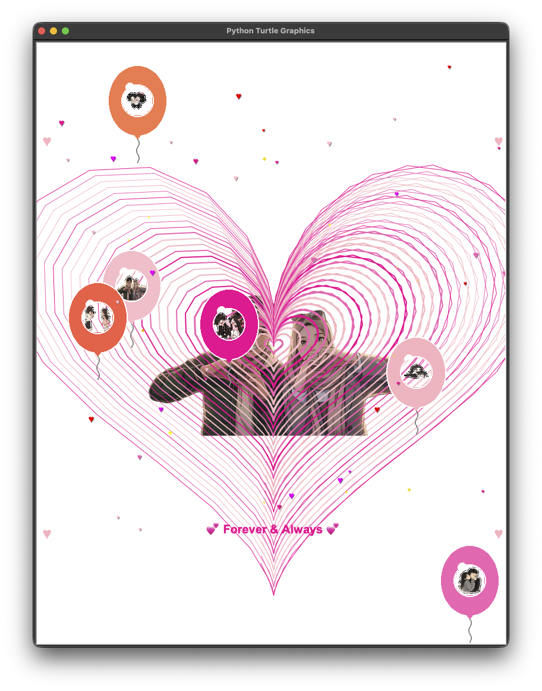
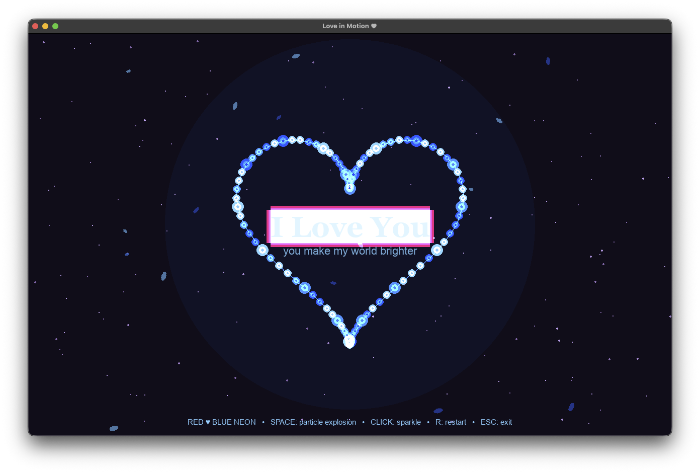
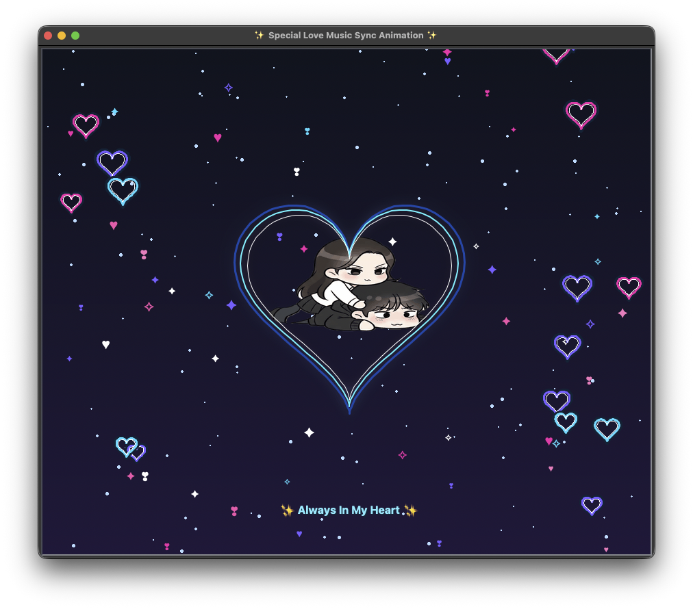

# 🎮 LopeForWhat

[](https://www.python.org/)
[](https://www.pygame.org/)
[](LICENSE)

**LopeForWhat** adalah sebuah aplikasi visual interaktif dan proyek game interaktif berbasis Python yang dibangun menggunakan pustaka **Pygame**. Proyek ini menampilkan animasi visual yang dinamis, interaktif, dan penuh estetika melalui beberapa variasi modul program.

---

## 📸 Showcase & Galeri Program

Berikut adalah tampilan visual dan alur animasi yang dihasilkan dari skrip utama hingga variasi modul program (`forwhat.py` – `forwhat5.py`):

| `forwhat.py` | `forwhat2.py` |
| :---: | :---: |
|  |  |
| *Tampilan Utama / Main Animation* | *Variasi Efek Visual & Interaksi 2* |

| `forwhat3.py` | `forwhat4.py / forwhat5.py` |
| :---: | :---: |
|  |  |
| *Dinamika Animasi 3* | *Variasi Tingkat Lanjut & Efek Khusus* |

---

## 🛠️ Prasyarat Sistem

Sebelum menjalankan proyek ini, pastikan sistem kamu telah memenuhi persyaratan berikut:
- **Python 3.11** atau versi yang lebih baru
- **Pip** (Python Package Manager)

---

## 🚀 Cara Instalasi dan Menjalankan

Ikuti langkah-langkah mudah di bawah ini untuk menjalankan proyek di komputer lokal kamu:

### 1. Klon Repository & Buka Terminal
```bash
git clone [https://github.com/username/LopeForWhat.git](https://github.com/username/LopeForWhat.git)
cd LopeForWhat

# 🎮 LopeForWhat

[](https://www.python.org/)
[](https://www.pygame.org/)
[](LICENSE)

**LopeForWhat** adalah sebuah aplikasi visual interaktif dan proyek game interaktif berbasis Python yang dibangun menggunakan pustaka **Pygame**. Proyek ini menampilkan animasi visual yang dinamis, interaktif, dan penuh estetika melalui beberapa variasi modul program.

---

## 📸 Showcase & Galeri Program

Berikut adalah tampilan visual dan alur animasi yang dihasilkan dari skrip utama hingga variasi modul program (`forwhat.py` – `forwhat5.py`):

| `forwhat.py` | `forwhat2.py` |
| :---: | :---: |
|  |  |
| *Tampilan Utama / Main Animation* | *Variasi Efek Visual & Interaksi 2* |

| `forwhat3.py` | `forwhat4.py / forwhat5.py` |
| :---: | :---: |
|  |  |
| *Dinamika Animasi 3* | *Variasi Tingkat Lanjut & Efek Khusus* |

> 💡 **Catatan:** Simpan file gambar tangkapan layar di dalam folder `assets/` dengan nama `preview1.png`, `preview2.png`, `preview3.png`, dan `preview4.png` agar muncul sempurna di halaman repository GitHub kamu.

---

## 🛠️ Prasyarat Sistem

Sebelum menjalankan proyek ini, pastikan sistem kamu telah memenuhi persyaratan berikut:
- **Python 3.11** atau versi yang lebih baru
- **Pip** (Python Package Manager)

---

## 🚀 Cara Instalasi dan Menjalankan

Ikuti langkah-langkah mudah di bawah ini untuk menjalankan proyek di komputer lokal kamu:

### 1. Klon Repository & Buka Terminal
```bash
git clone [https://github.com/username/LopeForWhat.git](https://github.com/username/LopeForWhat.git)
cd LopeForWhat

pip install -r requirements.txt
# Atau langsung install Pygame secara langsung:
# pip install pygame


LopeForWhat/
├── assets/             # Folder gambar preview dan aset game
│   ├── preview1.png
│   ├── preview2.png
│   ├── preview3.png
│   └── preview4.png
├── forwhat.py          # Skrip utama aplikasi
├── forwhat2.py         # Variasi modul 2
├── forwhat3.py         # Variasi modul 3
├── forwhat4.py         # Variasi modul 4
├── forwhat5.py         # Variasi modul 5
├── .gitignore          # Konfigurasi file yang diabaikan oleh Git
└── README.md           # Dokumentasi resmi proyek


